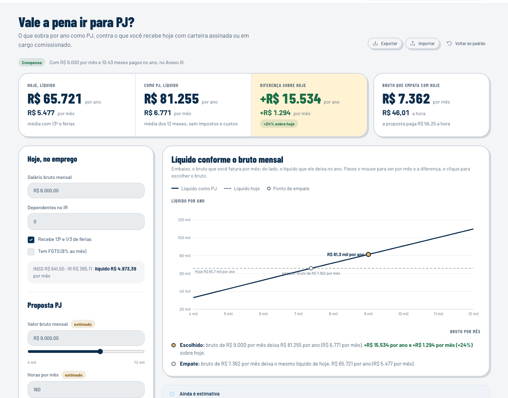

# Falcão PJ

Compara o que você recebe hoje, com carteira assinada ou em cargo comissionado, com o que sobraria trabalhando como PJ numa empresa do Simples Nacional. E guarda, item a item, o que o contrato define, para você chegar à reunião sabendo o que perguntar.

O projeto foi desenvolvido com o Claude Code como par de programação (detalhes em [Como foi feito](#como-foi-feito)).



## O que ele responde

- **Quanto você ganha hoje, quanto ganharia como PJ e a diferença**, por ano e por mês, em reais e em porcentagem. O líquido como PJ já desconta o DAS, o INSS e o IR do pró-labore e os custos do mês; o de hoje inclui 13º, 1/3 de férias e FGTS.
- **Qual bruto mensal empata** com o que você recebe hoje, e quanto vale a sua hora.
- **Que pró-labore usar** para a empresa ficar no Anexo III pelo Fator R, e quanto custa cair no Anexo V.
- **O que ainda falta confirmar no contrato.** Cada item é estimado, confirmado na reunião ou assinado, e o que ainda é estimativa vira uma lista de perguntas pronta para copiar.

## Telas

- **Painel.** O placar (hoje, como PJ e a diferença), o bruto de empate, o gráfico do líquido por bruto mensal, para onde vai o faturamento (por mês e por ano), cenários e a memória de cálculo.
- **Contrato.** Os itens que o contrato define, cada um com valor, situação e anotação.
- **Regras de 2026.** As tabelas de INSS, IR e Simples que a conta usa, com as premissas e as fontes.

## Rodar

Precisa do Node 22.18 ou mais novo.

```
git clone https://github.com/Falkzera/falcao-pj.git
cd falcao-pj
npm install
npm run dev
```

Abra `http://localhost:5188`.

## Seus dados ficam na sua máquina

O sistema não tem servidor e não manda nada para fora do navegador. O que você digita fica guardado no próprio navegador, e "Exportar" gera um arquivo para guardar ou levar para outro computador.

Para o sistema já abrir com os seus números, copie o exemplo para o arquivo pessoal e troque os valores:

```
cp dados/exemplo.json dados/meus-dados.json
```

- `dados/meus-dados.json` está no `.gitignore`. Ele não entra em commit, nem no seu fork, nem num pull request.
- O formato é o mesmo do arquivo exportado, então um export também serve como ponto de partida. Pode trazer só as partes que interessam, e o resto vem do exemplo.
- Ele só é lido no `npm run dev`. O `npm run build` deixa o arquivo de fora, para que um site publicado nunca leve os dados de quem o gerou.
- Depois da primeira abertura, vale o que está guardado no navegador. Para voltar ao arquivo, use "Voltar ao padrão".

## Como a conta é feita

**Hoje.** Salário menos o INSS progressivo e o IR do mês, pela opção mais barata entre as deduções legais e o desconto simplificado, já com a redução da Lei 15.270/2025. Somam-se o 13º, o 1/3 de férias e o FGTS, quando existem.

**Como PJ.** O faturamento do ano é o bruto mensal vezes os meses pagos, que são 12 menos os dias sem receber (descanso e feriados) divididos por 21 dias úteis. Dele saem o DAS do Simples, o INSS de 11% e o IR do pró-labore, e os custos do mês: o contador e as taxas, que toda empresa tem, e os outros gastos que você listar (assinatura, plano de saúde, equipamento). O pró-labore pode seguir o Fator R (28% do faturamento, o mínimo para o Anexo III), ficar em R$ 5 mil, no salário mínimo ou num valor livre.

Toda tabela fiscal mora em [`src/dominio/regras-2026.ts`](src/dominio/regras-2026.ts), e a tela de Regras mostra cada uma. Cada conta tem teste com o valor esperado calculado à mão a partir da tabela publicada, com a conta escrita no comentário.

## Limites

- A situação de hoje usa o INSS do regime geral, o da carteira assinada e do cargo comissionado. Regime próprio de servidor efetivo não está na conta.
- A empresa é de serviço (desenvolvimento de software, consultoria) no Simples Nacional, com Anexo III ou V pelo Fator R. MEI não serve para essas atividades, e lucro presumido não está na conta.
- O faturamento do ano faz o papel da receita dos últimos 12 meses. O primeiro ano da empresa e o acompanhamento mês a mês estão no [mapa de histórias](docs/mapa-de-historias.md).
- Ficam fora da conta a abertura da empresa, o atraso do primeiro pagamento, os dias doente sem receber e a aposentadoria menor.

É uma estimativa para decidir e negociar. Enquadramento e custos se confirmam com um contador.

## Contribuir

Contribuição é bem-vinda, do conserto de uma conta às tabelas de um ano novo. O caminho é fork, branch, `npm run verify` verde e pull request. O [CONTRIBUTING.md](CONTRIBUTING.md) explica como o código se organiza e o que o CI confere. Falha de segurança ou de privacidade vai pelo [SECURITY.md](SECURITY.md), não por issue.

## Como foi feito

Desenvolvi o Falcão PJ com o Claude Code como par de programação. As regras de cálculo, as decisões e a revisão do código são minhas, e cada conta fiscal tem um teste com o valor esperado feito à mão a partir da tabela publicada. O [`CLAUDE.md`](CLAUDE.md) na raiz e os `agent.md` de cada pasta, como [`src/dominio/`](src/dominio/agent.md), [`src/screens/`](src/screens/agent.md) e [`src/components/`](src/components/agent.md), são o contexto que o assistente lê antes de mexer no código, e também servem de mapa para quem chega para contribuir.

## Licença

O código está sob a [licença MIT](LICENSE). O nome Falcão e o símbolo são a marca do autor e não entram na licença: um fork que vire outro produto usa nome e marca próprios.
